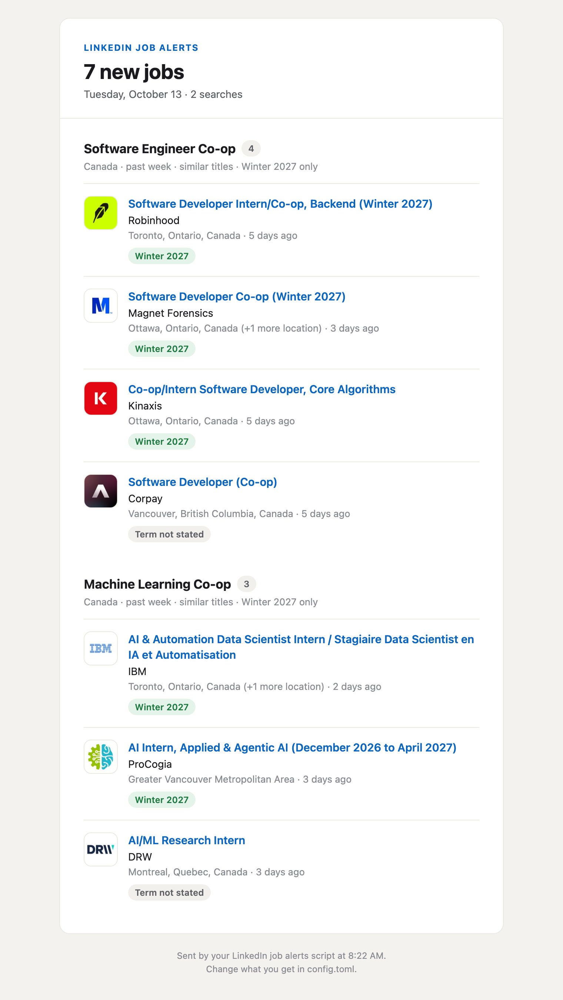

# LinkedIn Job Alerts
Searches LinkedIn every day for new job postings that match a list of job titles, and sends the new ones in an email (or a notification on your phone).



## How it works
Each search in `config.toml` has a job title, a location, and a time frame like the past 24 hours. The script uses LinkedIn's public job search, the same one you get when you are logged out, so no account or cookies are needed. It goes through the results page by page and pulls out the title, company, location, posting time, salary, and company logo for each job.

LinkedIn's search also matches job descriptions, so a lot of what comes back is not actually the job you searched for. Because of this, each job title is checked against the search title, and a job is only kept if its title covers every word of the search. Similar words count as the same word, so a search for Software Engineer Co-op also finds Software Developer Intern, SWE Internship, and Backend Engineer Co-op. The same groups of similar words are used to build the LinkedIn query, joining the alternatives with OR so one request covers all of them.

Searches can also be limited to one work term, like Winter 2027 (January to April). The term is read from the job title, or from the description when the title does not say, by looking for things like "Winter 2027", "Winter term", "January to April 2027", or a start date. Postings for a different term are dropped, and postings that never say when they are still get sent with a "Term not stated" label (or dropped, if `require_term` is on). Dates about school, like "graduating in Fall 2027", are ignored.

Every job that gets sent is saved in `seen_jobs.json`, so the same posting is never sent twice. LinkedIn also lists the same job once for every city it is in, so those are merged into one entry. The new jobs are grouped by search and sent as an HTML email, and optionally as a phone notification through ntfy. A launchd job runs the script at the times you pick, like once or twice a day. If nothing new turns up for 3 days (`checkin_days`), it sends a short check-in email instead, so a broken setup does not look the same as a quiet week.

## Results
On the Software Engineer Intern search in Canada, matching similar titles kept 4 of the first 20 LinkedIn results instead of 1. The extra matches were co-op and French language postings (like Stagiaire développeur(se) de logiciels, which is a software developer internship) that the exact word filter threw out. Titles like Mechanical Engineering Co-op, Software Analyst Intern, and Software Engineer, Internal Tools are still filtered out.

With the term set to Winter 2027, a week of co-op postings in Canada across four searches came out as 18 confirmed for Winter 2027, 7 that never said when, and 10 for other terms that were dropped. Most terms came from the title, but some were only in the description, like a City of Ottawa posting whose description said "Co-op Placement - Winter Term". The term check was also tested on 34 examples (10 real postings and 24 tricky phrasings, like a Summer internship that mentions graduating in Fall 2027), and got all of them right.

## Limitations
LinkedIn rate limits its public search after only a few quick requests. The script waits a few seconds between pages and backs off when it gets blocked. If a search still gets blocked part way through, the jobs from the pages it already loaded are kept, and a run stops after 30 minutes (`max_run_minutes`) and sends what it found. Any search that did not finish is mentioned in the email and checked again on the next run.

The scraping depends on the HTML of LinkedIn's search results. If LinkedIn changes it, the script can no longer read the listings, and it sends a warning email saying so instead of quietly finding nothing. The selectors in `parse_jobs()` (and `fetch_description()` for the term check) then need updating.

The groups of similar words are written by hand and lean towards software jobs. Other kinds of titles only match on their exact words unless more groups are added in `config.toml`.

The term check is based on patterns in the text, so a posting that describes its dates in an unusual way can be dropped or kept by mistake. Spring is treated as both Winter and Summer, since it means January to May at most US schools and May to August at most Canadian ones.

The script runs on your own Mac, not on a server, so alerts only go out while the Mac is on (see How to Run). A run that is missed while the Mac is shut down is skipped, so the time frame should be longer than the gap between runs, or postings from that gap will be missed.

Scraping LinkedIn goes against its User Agreement. This only reads public job listings, with a few dozen requests each run.

## Files
- `job_alerts.py` searches LinkedIn, filters the results, and sends the email and notification
- `config.example.toml` example config, copied to `config.toml` with the job titles, locations, time frame, and filters to search for
- `schedule.sh` sets up (or removes) the daily launchd job
- `.env.example` template for the email and ntfy settings

## Tech Stack
- Python
- Requests
- Beautiful Soup
- launchd
- ntfy

## How to Run
```bash
git clone https://github.com/KairavT/linkedin-job-alerts.git
cd linkedin-job-alerts
python3 -m venv venv
source venv/bin/activate
pip install -r requirements.txt
cp .env.example .env
cp config.example.toml config.toml
python3 job_alerts.py --preview
```
Fill in `.env` with a Gmail address and an [app password](https://myaccount.google.com/apppasswords) (a normal Gmail password will not work), or an ntfy topic, and put the jobs to search for in `config.toml`. `--preview` opens the email in the browser without sending anything, `--dry-run` prints the results instead, and `--test-notify` sends a test alert. `--lookback` does a one-off catch-up over the past 48 hours, for example after the Mac was off for a day or two. A different time frame can be given, like `--lookback 3d`, but the point is to spot jobs early, so it is kept short by default.

To run it every day at 8am:
```bash
./schedule.sh 8:00
```
More than one time works too, like `./schedule.sh 8:00 20:00` for twice a day. `./schedule.sh --remove` stops it, and the output of each run goes to `logs/job_alerts.log`.

The Mac has to be on and awake at the scheduled times for the email to arrive on time. If it is asleep (for example with the lid closed), the run happens as soon as the Mac is opened again, and if several runs were missed while it slept they are combined into one. If the Mac is shut down at a scheduled time, that run is skipped.
